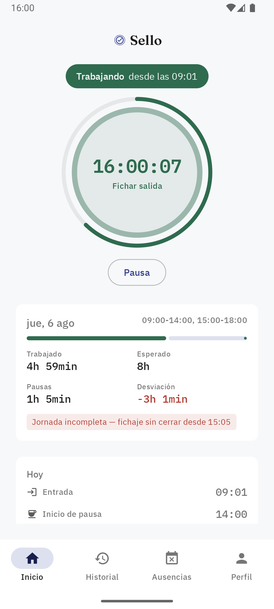
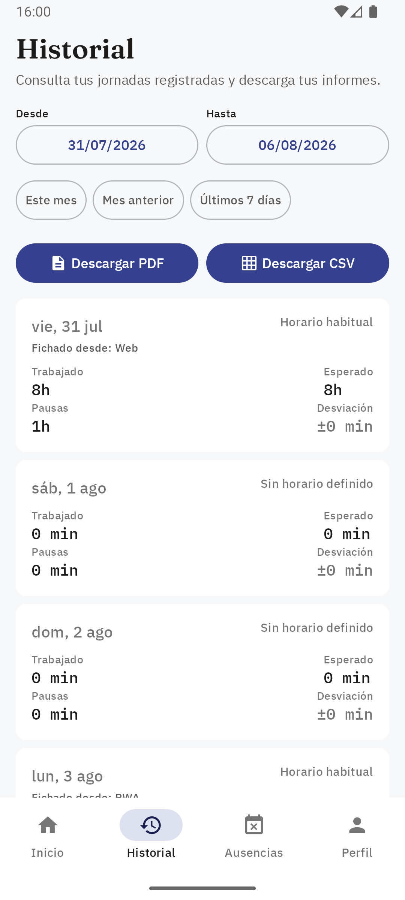
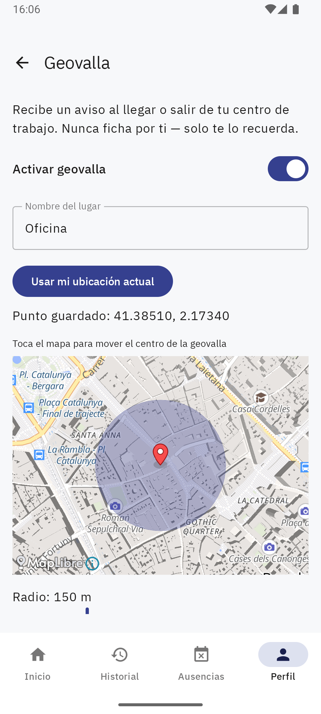
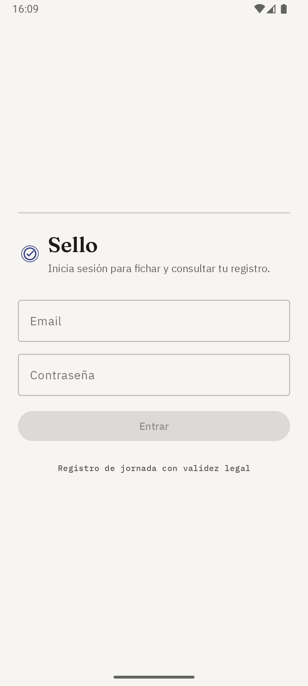
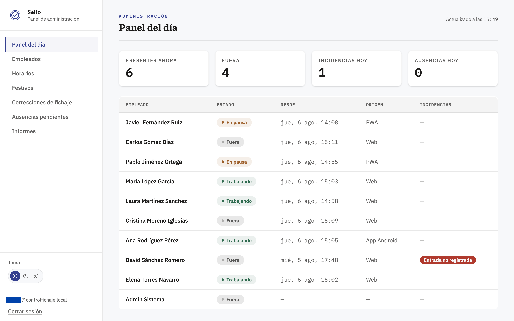
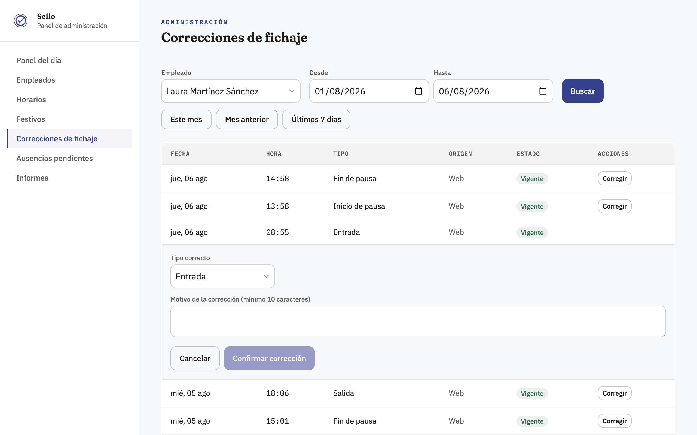
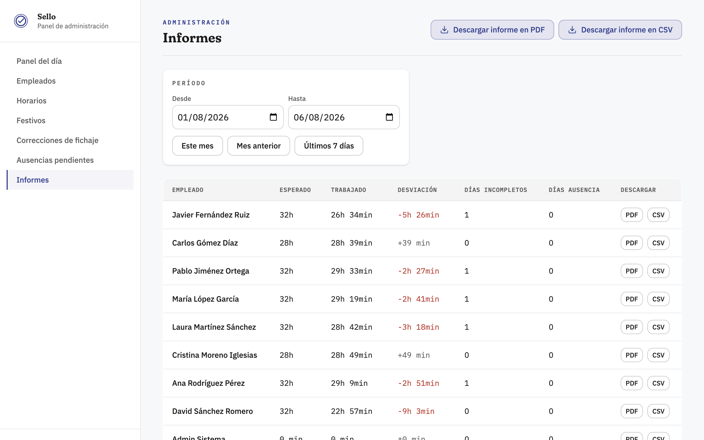
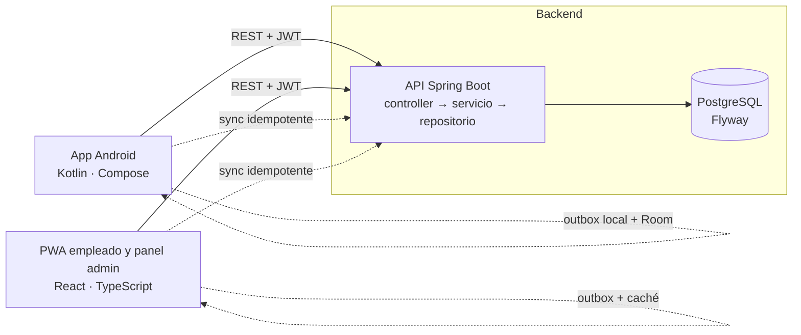

# Sello — Control horario para pymes

> Registro de jornada laboral en un toque, inmutable y auditable, para cumplir la normativa española sin Excel ni papel.

**English summary.** Sello is a working-time tracking product for Spanish SMEs (legally required registration of working hours). It ships as a native Android app (Kotlin, Jetpack Compose), an installable PWA (React) and a Spring Boot + PostgreSQL backend. Time records are append-only with audited corrections, and clock-ins work offline with idempotent sync. The source code is private because it is a commercial product; I'm happy to walk through it in an interview.

## Enlaces

- **Demo en vivo:** <https://control-fichaje.vercel.app> (la primera carga puede tardar 30-60 s: el backend gratuito "duerme"; los datos se restauran cada noche)
- **Ficha del proyecto:** <https://fherrera.dev/sello>

## Capturas

| App Android — Inicio | App Android — Historial | App Android — Geovalla |
|---|---|---|
|  |  |  |

| App Android — Login |
|---|
|  |

**Panel web de administración**

## El problema

En España, el registro diario de la jornada es obligatorio para cualquier empresa (art. 34.9 del Estatuto de los Trabajadores, RDL 8/2019). Muchas pymes lo resuelven todavía con hojas de Excel o partes de papel: sin trazabilidad real y sin una forma sencilla de entregar el registro a un trabajador o a la Inspección de Trabajo si lo piden.

Sello cubre ese hueco con un producto llave en mano: una instalación por cliente, autoalojada, sin más dependencias que Docker.

## Funcionalidades

**Empleado** (app Android nativa y PWA instalable)
- Fichaje de entrada, pausas y salida en un toque, con la hora generada siempre por el servidor.
- Fichaje sin conexión: se guarda con la hora real y se sincroniza solo al volver la red, marcado como tal.
- Historial con caché offline y descarga de su propio registro en PDF/CSV.
- Solicitud de ausencias y consulta de su horario.
- Android: widget de pantalla de inicio, geovalla con mapa que avisa al llegar o salir del centro de trabajo, tema claro/oscuro.

**Administración** (panel web, escritorio primero)
- Panel del día: quién trabaja, está en pausa o fuera, con incidencias señalizadas.
- Gestión de empleados, horarios, excepciones y festivos.
- Corrección de fichajes con motivo obligatorio y autoría registrada.
- Bandeja de ausencias pendientes.
- Informes por empleado y de empresa, exportables a PDF y CSV.

## Stack

| Capa | Tecnologías |
|---|---|
| **Android** | Kotlin, Jetpack Compose + Material 3, MVVM, Hilt, Retrofit + kotlinx.serialization, Room, WorkManager, Glance (widget), Geofencing + MapLibre, ktlint, Kover |
| **Backend** | Java 21, Spring Boot 4.1, Spring Security (JWT), Spring Data JPA, springdoc/OpenAPI, Testcontainers |
| **Web** | React 19, TypeScript, Vite, Tailwind CSS v4, PWA, Vitest + Testing Library |
| **Base de datos** | PostgreSQL 16, migraciones con Flyway |
| **Despliegue y CI** | Docker Compose, GitHub Actions; demo pública en Vercel (web) + Render (API) + Neon (Postgres) |

## Arquitectura

Cada cliente mantiene una cola local para los fichajes hechos sin conexión y los envía al recuperar la red; el servidor garantiza la idempotencia de cada envío.

## Decisiones técnicas destacadas

- **Fichajes inmutables:** nunca se edita ni se borra un registro; una corrección inserta un evento nuevo enlazado al original, con motivo y autor.
- **Refresh token opaco con detección de reutilización:** solo se persiste su hash y, si se reutiliza un token ya rotado, se revoca toda la familia.
- **Fichaje offline auditado:** el cliente envía la hora capturada y un UUID de idempotencia, y el servidor marca las incoherencias de secuencia para revisión en vez de rechazarlas.
- **Capa de dominio en Kotlin puro en Android:** sin dependencias del framework, para que una futura migración a Kotlin Multiplatform sea barata.

## Mi papel

Diseñé y desarrollé el producto completo en solitario: la app Android nativa (arquitectura, UI, modo offline, widget y geovalla), el backend y la API, el panel web/PWA, el modelo de datos y las migraciones, y la puesta en marcha de la demo pública con integración continua.

El desarrollo se ha apoyado en herramientas de IA (asistentes de programación) como acelerador: yo defino los requisitos, las decisiones de arquitectura y de producto, reviso el código generado y valido el resultado de cada hito en emulador y contra el backend real.

## Sobre el código

El código fuente es privado porque Sello es un producto comercial. Puedo enseñarlo y explicarlo en una entrevista.

## Contacto

Fernando Herrera Monroy — Desarrollador full-stack con especialidad en Android
**contacto@fherrera.dev** · GitHub: [ferchio9](https://github.com/ferchio9)
